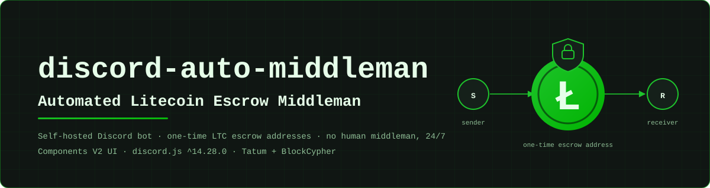

<p align="center">
  
</p>

# Contributing to discord-auto-middleman

Thanks for helping out. This bot custodies real LTC for real trades, so the rules below favour small, reviewable, boring changes. The technical source of truth is the [README](README.md); the developer rules are summarised in its [Making changes](README.md#making-changes) section and expanded here for contributors.

##  Table of contents

- [Ground rules](#ground-rules)
- [Branch and PR workflow](#branch-and-pr-workflow)
- [Commit messages](#commit-messages)
- [PR checklist](#pr-checklist)
- [Reporting bugs](#reporting-bugs)
- [How to add an emoji](#how-to-add-an-emoji)
- [How to add a slash command](#how-to-add-a-slash-command)
- [How to test offline](#how-to-test-offline)
- [Do-not-touch list](#do-not-touch-list)
- [License](#license)

##  Ground rules

- **Never post or commit secrets.** That means `config.toml`, `trades.json` (it contains escrow private keys), bot tokens, webhook URLs, the Tatum `mnemonic` / `xpub` / API key, and BlockCypher tokens. Redact them in logs and screenshots.
- **UI/markup goes through `functions/ui.js` (`Card`).** No `EmbedBuilder`, no hand-rolled components, no `content:` beside a CV2 payload.
- **CV2 hard rules:** never send `components: []` (send a buttonless card instead); never edit a CV2 message with `content`.
- **Every `customId` is either listed in the [Button & interaction registry](README.md#button--interaction-registry) or uses its own prefix** (like `uitest_*`) so the dispatcher ignores it.
- **Pings are opt-in.** Cards default to `allowedMentions: { parse: [] }`; use `allowPing: true` only where a ping is intended.
- **Known quirks are protected.** Everything in [Known quirks & technical debt](README.md#known-quirks--technical-debt) is preserved on purpose. Changing one is a deliberate, separately discussed decision, never a drive-by cleanup.
- **UI pull requests contain no logic changes.** If a UI change needs a logic change, split it into two PRs.

##  Branch and PR workflow

1. Fork the repository (or create a branch if you have write access) and branch off `main`: `git switch -c feat/short-topic`. Do not commit directly to `main`.
2. Keep each branch to **one topic**; small PRs are reviewed faster and are safer for an escrow codebase.
3. Make the change, then run the checks in the [PR checklist](#pr-checklist).
4. Open a pull request against `main` describing *what* changed, *why*, and how you verified it.
5. Rebase on `main` if it moved, and address review comments with follow-up commits.

##  Commit messages

Format: `type(scope): imperative summary`. Use one scope per commit.

| Pattern | Use for |
|---------|---------|
| `feat(ui): …` | new design-system capability |
| `feat(emoji-sync): …` | emoji pipeline features |
| `fix(uitest): …` | fixes in the `/uitest` visual lab |
| `cv2(trade3): …` | one cluster of the CV2 conversion of a file |
| `process/readme: …` | documentation and process changes |

Write the summary in the imperative ("add", "fix", "rename"), keep it short, and make sure the syntax check passes before you commit.

##  PR checklist

Copy this into your PR description:

```
- [ ] Syntax check passes for every touched file (node --check <file>); whole repo stays green
- [ ] UI changes: /uitest screenshots attached (before/after where it helps)
- [ ] No logic changes in a UI PR
- [ ] No secrets, config.toml, trades.json, cv2/ or node_modules/ in the diff
- [ ] New customIds are in the registry table or use an isolated prefix
- [ ] No protected quirk changed (or the change is explicitly called out and agreed)
- [ ] README/diagrams updated if a flow, command, config key or timer changed
```

Syntax check for the whole repo: bash `git ls-files '*.js' | xargs -n1 node --check`, PowerShell `git ls-files "*.js" | ForEach-Object { node --check $_ }`.

##  Reporting bugs

Use the same shape as the bot's `/support` flow (Bot Related / General Support / Cancel Request): who, where, what. Open an issue with:

```
Category:       Bot Related | General Support | Cancel Request
Where:          channel / thread (ID or link), and which stage of the trade
                (see README "How an escrow trade works": Stage 0-9)
What happened:  one or two sentences
Expected:       what you thought would happen
Steps to repro: 1. ...  2. ...  3. ...
Environment:    Node version, discord.js version (npm ls discord.js), OS
Logs:           relevant lines from combined.log / console (secrets removed)
```

Rules for reports: remove tokens, webhook URLs, mnemonics, private keys and full escrow keys. A trade-thread ID and the on-screen card name (for example "Transaction Not Detected") are usually enough to locate the code path. For a security problem involving funds or keys, do **not** open a public issue; contact the maintainer ([irtasam](https://github.com/iamirtasam)) directly.

##  How to add an emoji

Emojis live in **`emojis.txt`** (single source of truth) and are used in code as `${E.Name}`. One line per emoji, three formats:

```
# 1) direct markup: an emoji ID that already exists somewhere
elite_LTC = <:elite_LTC:1494053153350357022>
check     = <a:green_tick:1481611281415798871>

# 2) bundled file (relative to repo root, preferred)
Money = ./assets/emojis/Money.png

# 3) remote image (CDN url, also uploads)
faq = https://cdn.discordapp.com/emojis/1494053058668396735.png
```

Preferred route: drop the PNG into `assets/emojis/` and add a `Name = ./assets/emojis/Name.png` line.

**Auto-sync caveats:**

- Upload sync (`functions/emojiSync.js`) runs **on startup**, before anything else. Restart the bot after adding a bundled-file or URL source so it gets uploaded.
- A source whose name is **already uploaded is reused**, not replaced. To use a different image, give the emoji a new name rather than expecting the old upload to change.
- Edits to `emojis.txt` are picked up live within about one second, but that only covers the file; uploads still happen at startup.
- An unknown key returns `''` and logs a console warning, so a typo silently renders nothing.
- Verify with `/emojicheck` after the `[emoji-sync] done - X uploaded, Y reused, Z failed` log line.

##  How to add a slash command

**File contract:** one file per command in `slashcommands/`, exporting:

- `data`: the slash-command definition (name, description, options, default member permissions);
- `execute`: the handler that receives the interaction.

**Loader behaviour you should know:**

- `handlers/command.js` loads only files matching `slashcommands/*.js`; a file such as `balance1.js.old` is **not** loaded.
- `events/interactionCreate.js` re-reads `slashcommands/` at each chat-input interaction, so edits to an existing command's `execute` take effect without a restart.
- `events/ready.js` registers commands **globally** (`Routes.applicationCommands`) on startup, so a **new** command or a changed `data` definition needs a restart, and global commands can take a while to propagate.

**Checklist for a new command:**

1. Build any output with `Card` from `functions/ui.js`, and use `flags` rather than the deprecated `ephemeral: true`.
2. Spell the permission flag correctly: `PermissionFlagsBits.Administrator`. The repo has existing `Admininstrator` typos (a protected quirk), and a correctly spelled flag still needs a **runtime check** like `/uitest` has if the command must be admin-only.
3. Any buttons need a `customId` from the registry or an isolated prefix.
4. Add the command to the [Slash command reference](README.md#slash-command-reference).
5. `node --check` the new file and restart the bot.

##  How to test offline

There is no automated test suite, so verification is manual and layered:

1. **Syntax:** `node --check <file>` for every touched file.
2. **`/uitest`:** the in-Discord CV2 visual lab (typography, media, palette, button-state harness). All its buttons use the `uitest_*` namespace and are inert to the dispatcher, so it is safe to extend. It needs a running bot, a config and a test server, but no real money.
3. **CV2 sandbox dry-run (no token needed):** build your card in a scratch script outside the repo, using a `discord.js@14.28.0` install, and push the payload through the real `MessagePayload.resolveBody()` path. That validates the builder output (component structure, flags, `allowedMentions`) without touching Discord. This is the approach the maintainer used during the CV2 migration.

Never test with real funds on a production `trades.json`.

##  Do-not-touch list

- `config.toml`, `trades.json`, `cv2/` (git-ignored reference notes), `node_modules/`.
- The protected quirks in [Known quirks & technical debt](README.md#known-quirks--technical-debt) unless the PR is explicitly about changing one.

##  License

This project is released under the [ISC License](LICENSE). By submitting a contribution you agree that it is licensed under the same terms. See the [README](README.md#license) as well.
